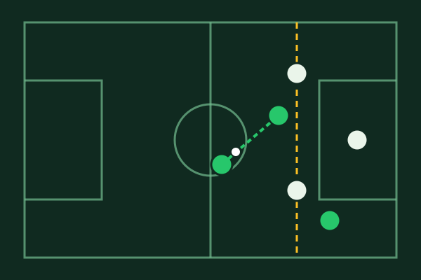
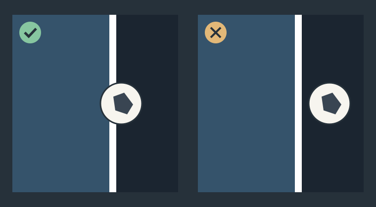
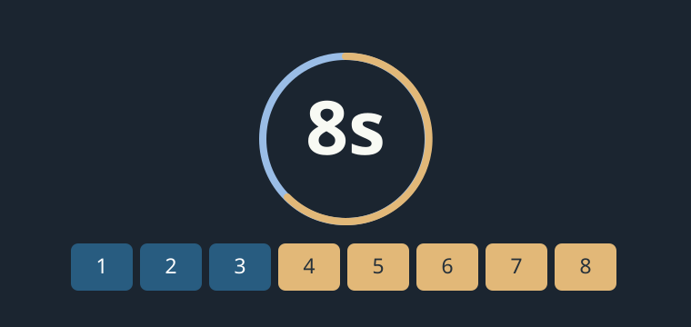
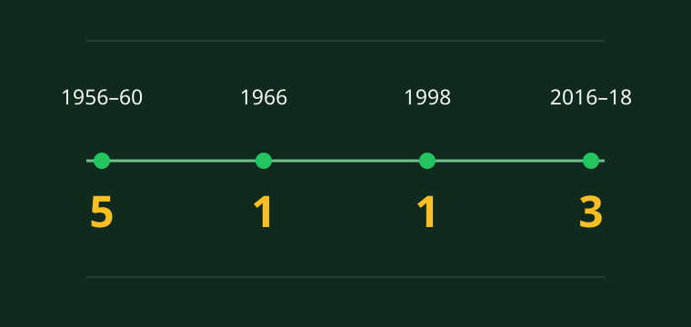
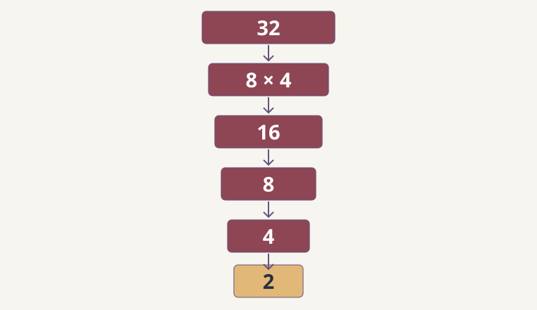
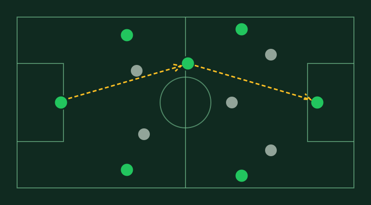
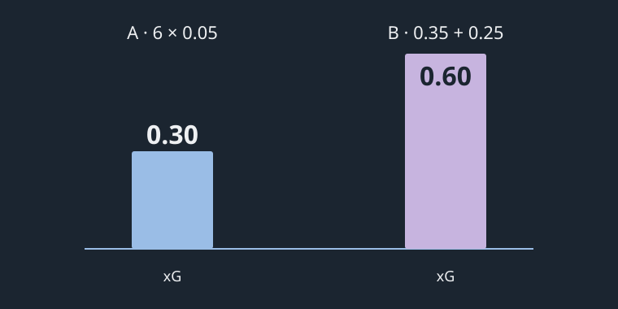

# Futebolando — caderno de revisão editorial

Versão de conteúdo: 202addd2d8f1000da146ce4d37402300102a4d46. Blob: 8f77552f0075cad6e8d9f8daa4e28c9d44d17832. Oito artigos e 16 edições; conferência assistida realizada, aprovação humana pendente. Este arquivo é uma apresentação de leitura do catálogo, não fonte editorial editável. Não é uma autorização de publicação. As alterações devem ser feitas em Futebolando/editorial/articles.json e novamente sincronizadas.

## Como revisar

Leia os textos, confirme precisão, clareza, referências e ilustrações, e indique o ID da matéria e os pontos a corrigir. Aprovar texto não significa autorizar indexação ou monetização. A versão inglesa exige revisão linguística independente; a Libertadores ainda requer conferência visual do PDF e circulares aplicáveis. As ilustrações originais esquemáticas devem ser avaliadas com o texto.

## Índice

1. [Offside: understanding position and involvement in play](#offside-guide)
2. [Which restarts are exempt from offside offences?](#offside-restarts)
3. [When is the ball really out of play?](#ball-in-play)
4. [The goalkeeper's eight seconds: why the sanction became a corner](#goalkeeper-eight-seconds)
5. [Real Madrid: how a European winning tradition took shape](#real-madrid-history)
6. [How does the Libertadores work? The 2026 format and tie-breakers](#libertadores-format)
7. [Barcelona: from Cruyff to Guardiola, what is positional play?](#barcelona-positional-play)
8. [What is xG? Why not all shots are equal](#expected-goals)

---

## 1. Offside: understanding position and involvement in play

**ID:** `offside-guide` · **Status:** rascunho, revisão humana pendente.

A forward receives the ball, scores and then notices the flag. To understand the decision, separate two questions: where was the player, and how did they become involved?

**Ilustração:** Schematic pitch with a defensive line and player positions, not depicting an actual match.

### Understand it in 30 seconds

An advanced position is not an offence on its own. The referee must consider where a player was when a teammate played the ball and how that player became involved afterwards. Both position and involvement matter.

*Referências: 1.*

### See it in practice

Picture a midfielder about to release two forwards. One is already beyond the defence; the other holds back. If the first was in an offside position at the relevant instant and receives the pass, an offence can occur. If the second was onside and receives the ball while the first has no impact on play, the move can continue.

Both forwards might finish their runs in the same place. What matters is their position at the reference moment and what each does afterwards. Looking only at the moment the ball arrives can therefore be misleading.

*Referências: 1.*

### What does Law 11 say?

To be in an offside position, a relevant part of the player's body must be in the opponents' half, excluding the halfway line, and closer to the goal line than both the ball and the second-last opponent. The head, body and feet count, but hands and arms do not; the arm boundary is level with the bottom of the armpit. A player level with the second-last opponent or with the last two opponents is onside.

The next question is involvement. A player may become involved by playing the ball, interfering with an opponent or benefiting from certain rebounds, deflections or saves. If an offside offence occurs, the opposing team receives an indirect free kick where it occurred.

*Referências: 1.*

### When position is only part of the story

A forward may clearly obstruct a goalkeeper's view without touching the ball. Another player may stand in an advanced position without affecting play. How the ball arrives can also matter: direct receipt from a throw-in is one of the exceptions explored in the next episode.

Another distinction arises when the ball reaches a defender. A mere deflection does not necessarily remove the offside restriction, whereas a deliberate play by an opponent can allow the forward to receive the ball legally. A deliberate save is an exception to the latter principle. The key is not simply whether a defender touched the ball, but what kind of action took place.

*Referências: 1.*

### The timing of the pass has changed too

The 2025/26 edition introduced a specific reference for a goalkeeper's throw: the end of contact with the ball. For other plays or touches by teammates, the beginning of contact is used. This helps explain why the reference frame depends on how the ball was played.

*Referências: 2, 1.*

### Fontes

1. [IFAB — Law 11: Offside (2026/27 edition consulted)](https://www.theifab.com/laws/latest/offside/) — consulta registrada: 2026-11-26.
2. [IFAB — Law changes 2025/26](https://www.theifab.com/law-changes/2025-26/) — consulta registrada: 2026-11-26.

---

## 2. Which restarts are exempt from offside offences?

**ID:** `offside-restarts` · **Status:** rascunho, revisão humana pendente.

A forward can receive the ball beyond the defence without the flag going up. For certain restarts, the laws explicitly allow that outcome.

### Understand it in 30 seconds

There is no offside offence when a player receives the ball directly from a throw-in, a goal kick or a corner kick. The exception applies to that receipt, not every subsequent pass.

*Referências: 1.*

### See it in practice

Imagine a throw-in near the opponents' penalty area. A forward stands beyond the defenders and receives the ball directly from the thrower. That position would attract attention during an ordinary pass, but the source of the ball changes the situation.

The distinction is easy to miss. The player has not gained permission to remain offside for the rest of the move; this particular receipt is simply treated differently.

*Referências: 1.*

### What does Law 11.3 say?

All three exceptions concern direct receipt from a specified restart. Directly is the key word because it limits how far the exception extends. A free kick, for instance, is not one of the three listed restarts.

Two moves may look remarkably similar and still require different decisions. Before assessing offside, it helps to establish where the ball came from.

A goal kick should not be confused with a goalkeeper's ordinary distribution during open play. The former is a specified exempt restart; the latter requires the normal offside assessment.

*Referências: 1.*

### The next pass can change everything

Return to the throw-in example. If the forward receives the ball and passes it to another teammate, the new touch can require a normal offside assessment. The exception attached to the first receipt does not settle the next phase.

*Referências: 1.*

### The detail behind different decisions

Next time you watch a match, notice the restart before looking at the forwards' positions. This simple habit helps distinguish the three exceptions from an ordinary pass, and a correct decision from an apparent refereeing error.

*Referências: 1.*

### Fontes

1. [IFAB — Law 11: Offside (2026/27 edition consulted)](https://www.theifab.com/laws/latest/offside/) — consulta registrada: 2026-11-26.

---

## 3. When is the ball really out of play?

**ID:** `ball-in-play` · **Status:** rascunho, revisão humana pendente.

The ball appears to have gone out, yet the referee lets play continue. Understanding exactly what must cross the line helps explain why.

**Ilustração:** Two overhead examples: a ball still overlapping the line and another entirely outside the field.

### Understand it in 30 seconds

The whole ball must cross the touchline or goal line to be out across that boundary. If any part still overlaps the line, it has not fully crossed. The same principle applies on the ground and in the air.

*Referências: 1.*

### See it in practice

Look at the two illustrations. In the first, much of the ball is beyond the white line, but part still overlaps it. In the second, the entire ball is past the outside edge.

Television pictures can draw our attention to the spot where the ball touches the grass. The diagram reminds us that the ball has volume, and the decision concerns the whole of it rather than its base.

*Referências: 1.*

### What does Law 9 say?

Crossing a boundary is not the only way play stops: the referee can also stop the game. Without another reason to stop, a ball that rebounds from the posts, crossbar or corner flag and stays inside the field may remain in play.

That raises a further question. What if the ball hits someone who is not competing for it? Contact with a match official is subject to specific conditions.

*Referências: 1.*

### What if the ball strikes the referee?

Contact with a match official, including an assistant referee, is not enough on its own to stop the move. If the ball remains on the field but possession changes, a promising attack begins or the ball goes straight into a goal, play resumes with a dropped ball. Outside those circumstances, contact itself does not require play to stop.

The 2026/27 edition also covers a specific situation: if a team official, substitute, substituted or sent-off player, or a player temporarily off the field, touches a ball that is clearly going out while it is still in play, without intending to interfere unfairly, the other team receives an indirect free kick. No disciplinary sanction is imposed for that contact alone. This differs from waiting for the ball to cross the boundary completely.

*Referências: 1.*

### Why the camera angle matters

An angled view may conceal the portion of the ball that still overlaps the line. When watching a replay, look for a perspective that reveals the outside edge. A single image can seem decisive without showing everything the decision requires.

*Referências: 1.*

### Fontes

1. [IFAB — Law 9: The Ball in and out of Play (2026/27 edition consulted)](https://www.theifab.com/laws/latest/the-ball-in-and-out-of-play/) — consulta registrada: 2026-11-26.

---

## 4. The goalkeeper's eight seconds: why the sanction became a corner

**ID:** `goalkeeper-eight-seconds` · **Status:** rascunho, revisão humana pendente.

Holding the ball for too long no longer leads to the old indirect free kick sanction. A new time limit and a corner kick have changed how this situation is handled.

**Ilustração:** Eight-second timeline highlighting the final five seconds of the referee’s visible countdown.

### Understand it in 30 seconds

If a goalkeeper controls the ball with their hands or arms inside their own penalty area for longer than eight seconds, the opposing team receives a corner. The referee determines when control begins and makes the last five seconds visible.

*Referências: 1.*

### See it in practice

Imagine a goalkeeper catching a shot and holding the ball against their chest. After waiting a few seconds, they bounce it, catch it again and look for a teammate to receive the ball.

The countdown does not restart with each bounce because the goalkeeper remains in control. To understand the referee's decision, watch when that control was established rather than counting only the time spent standing still.

*Referências: 1.*

### What does Law 12.3 say?

The referee decides when the goalkeeper has control of the ball. During the final five seconds, a raised hand makes the countdown visible. If the limit is exceeded, the corner is taken from the side nearest the goalkeeper's position when penalised.

A first offence does not automatically bring a yellow card. Repeated offences, however, can lead to a caution. The restart and the disciplinary decision are separate matters.

*Referências: 1.*

### What if an attacker prevents release?

An opponent cannot challenge a goalkeeper who has the ball under control with their hands or arms. If an attacker prevents release, the referee must assess that interference rather than applying the time limit as though the goalkeeper had been free to distribute the ball.

If an attacker prevents release and there is no advantage to apply, the referee penalises the offence in favour of the goalkeeper's team: a direct free kick when the attacker makes contact with the goalkeeper, or an indirect free kick without contact. A caution depends on the circumstances, such as a reckless action or interference with a promising attack.

*Referências: 1.*

### From six seconds to eight

The 2025/26 change replaced the previous six-second limit and indirect free kick with an eight-second countdown and a corner for exceeding it. It is a useful example of how the laws can change even when the situation on the pitch looks familiar. For older matches, check the rules that applied at the time.

*Referências: 2, 1.*

### Fontes

1. [IFAB — Law 12: Fouls and Misconduct (2026/27 edition consulted)](https://www.theifab.com/laws/latest/fouls-and-misconduct/) — consulta registrada: 2026-11-26.
2. [IFAB — Law changes 2025/26](https://www.theifab.com/law-changes/2025-26/) — consulta registrada: 2026-11-26.

---

## 5. Real Madrid: how a European winning tradition took shape

**ID:** `real-madrid-history` · **Status:** rascunho, revisão humana pendente.

The Spanish club has a distinctive connection with Europe's leading club competition. Its story is best understood through different generations rather than trophies alone.

**Ilustração:** Selected milestones in Real Madrid's European Cup history: five from 1956 to 1960, titles in 1966 and 1998 and three from 2016 to 2018. Not a complete list.

### The beginnings of an identity

When Madrid Foot Ball Club elected its first board on 6 March 1902, the competition now known as the Champions League did not exist. More than half a century later, European football would become central to the club's identity.

The arrival of the European Cup in the 1950s coincided with a generation led on the pitch by Alfredo Di Stéfano. Madrid won the first five editions, from 1956 to 1960. That run helps explain why the club became so closely associated with the tournament.

*Referências: 1, 2.*

### What the different winning cycles reveal

The sixth title arrived in 1966. A 32-year wait followed: in May 1998, Madrid beat Juventus 1–0 through a goal by Mijatovic. That interval helps reveal a less straightforward history than a trophy list might suggest.

The competition adopted the Champions League name in 1992/93. Madrid won three consecutive editions between 2016 and 2018. UEFA's honours list dated 30 May 2026 counted 15 titles since 1955/56, nine of them in the Champions League era. The illustration selects milestones rather than listing every title.

*Referências: 2, 3.*

### Do trophies explain everything?

The record invites questions about how clubs manage changes in personnel, coaches and competitive conditions. A trophy list, however, records outcomes rather than establishing the causes of each victory. Assessing recruitment, investment or player development would require financial documents and evidence from different seasons.

The same caution applies to a future campaign. Madrid's history makes it a European benchmark, but does not replace an assessment of its available squad, opponents and recent performances.

*Referências: 1, 2.*

### What to look for next

When comparing Europe's major clubs, keep their historical records separate from present form. Trophies tell us about the past; chance creation and chances conceded can help us interpret current performances. That distinction will also matter in our articles about Barcelona and expected goals.

*Referências: 2.*

### Fontes

1. [Real Madrid — 124 years of club history (6 March 2026)](https://www.realmadrid.com/en-US/news/club/latest-news/124-anos-de-leyenda-06-03-2026) — consulta registrada: 2026-11-26.
2. [UEFA — European Cup / Champions League honours, 30 May 2026](https://www.uefa.com/uefachampionsleague/news/0275-1541637ad1db-88aeeefefefd-1000--all-time-european-cup-honours-board/) — consulta registrada: 2026-11-26.
3. [Real Madrid — 28 years since winning the seventh European Cup (20 May 2026)](https://www.realmadrid.com/en-US/news/club/latest-news/hace-28-anos-se-gano-la-septima-copa-de-europa-20-05-2026) — consulta registrada: 2026-11-26.

---

## 6. How does the Libertadores work? The 2026 format and tie-breakers

**ID:** `libertadores-format` · **Status:** rascunho, revisão humana pendente.

From qualifying rounds to the single-match final, follow the route to the trophy and understand the change to group-stage tie-breakers.

**Ilustração:** 2026 Libertadores format: 32 teams, eight groups of four, 16 in the round of 16, eight in the quarter-finals, four in the semi-finals and two finalists.

### The route begins before the groups

For some teams, the Libertadores begins with preliminary knockout rounds. The group stage then brings together 32 clubs. In 2026, they were divided into eight groups of four, with each side meeting its three opponents at home and away.

After six matches, the top two teams in each group advance to the round of 16. Third-placed teams still have a continental opportunity, but in a different competition: the Sudamericana knockout round play-offs.

*Referências: 2.*

### The group-stage tie-break changed in 2026

A group-stage win is worth three points, a draw one and a defeat none. When teams finish level on points, the edition's regulations determine their order.

The February 2026 edition of the manual first compares the games between the tied clubs: points, goal difference and goals scored, in that order. If needed, overall group goal difference and goals scored follow. Further ties are settled by fewer red cards, then fewer yellow cards, and finally a draw of lots. The manual also says that earlier criteria are not reapplied if a new tie arises.

In 2025, overall goal difference came first. That edition's manual also used away goals in the group stage and the CONMEBOL club ranking later in its tie-break sequence. Those criteria should not be carried over automatically to 2026.

*Referências: 1, 3.*

### Why the final works differently

The round of 16, quarter-finals and semi-finals are played over two legs. With points level, aggregate goal difference decides the tie; if the teams are still level, a penalty shoot-out settles it without extra time. There is no additional away-goals tie-break.

The 2026 final is played as a single match. If the teams are level after normal time, the manual provides for another 30 minutes, split into two 15-minute periods. A shoot-out follows only if the scores remain level.

*Referências: 1, 2.*

### An example for reading the table

Imagine two clubs finishing a group with ten points. One has the better overall goal difference, but the other earned more points in their meetings. Under the 2026 first tie-breaker, the latter ranks higher. This fictional example shows why the head-to-head results matter before consulting the goal-difference column.

Check the applicable regulations before comparing standings from different seasons. The overall format may be familiar even when a significant detail has changed.

*Referências: 1.*

### Fontes

1. [CONMEBOL — Manual de Clubes Libertadores 2026, versão atualizada de fevereiro, §§2.2–2.4, pp. 54–55](https://cdn.conmebol.com/wp-content/uploads/2025/12/CL-2026-Manual-de-Clubes-POR-2.pdf) — consulta registrada: 2026-11-26.
2. [CONMEBOL — Grupos da Libertadores 2026, 19 de março](https://gol.conmebol.com/libertadores/pt-br/news/rumo-gloria-eterna-este-sao-os-grupos-da-conmebol-libertadores-2026) — consulta registrada: 2026-11-26.
3. [CONMEBOL — Manual de Clubes Libertadores 2025, §2.4](https://cdn.conmebol.com/wp-content/uploads/2025/01/Manual-de-Clubes-CL-2025-POR-Digital.pdf) — consulta registrada: 2026-11-26.

---

## 7. Barcelona: from Cruyff to Guardiola, what is positional play?

**ID:** `barcelona-positional-play` · **Status:** rascunho, revisão humana pendente.

Positional play involves more than having the ball. It is about occupying space and creating routes to advance, an idea illuminated by Barcelona's history.

**Ilustração:** Schematic pitch showing players spread across width and depth and a third-player combination; hypothetical example, not a reconstruction of a match.

### An idea across generations

When Johan Cruyff took charge of Barcelona in 1988, the club entered a period associated with attacking football and ball circulation. His Dream Team won four consecutive Spanish league titles, from 1991 to 1994, and Barcelona's first European Cup in 1992.

Guardiola, who had played in that side, returned as head coach in 2008. His first season brought the Spanish league, Copa del Rey and Champions League. By the end of his four seasons in 2012, he had won 14 trophies, including two Champions League titles. Those results put the period in perspective; to understand its tactical ideas, look at how the players occupied the pitch.

*Referências: 1, 2.*

### Space before the ball

One way to understand positional play is to watch how players spread out when their team has possession. Some provide width near the touchlines; others offer depth by occupying more advanced areas. Players may rotate, but passing options still need to be available.

The structure aims to give the ball carrier alternatives. If defenders gather on one side, for instance, circulating the ball can open a route on the other. A pass is then more than a transfer of possession between teammates: it can move the defence and prepare the next progression.

FIFA's training material illustrates general principles of width, depth, rotations and third-player combinations. It is not an analysis of historical Barcelona matches. The comparison here explains the concept without assigning a fixed formation or a single cause to the club's achievements.

*Referências: 3.*

### The third-player combination in practice

Picture three players: a defender, a midfielder and a forward. The direct passing lane between defender and forward is blocked. The defender finds the midfielder, who can then play into the forward in a better receiving position. A combination through the intermediate player has bypassed the pressure.

The accompanying diagram is a hypothetical teaching example, not a reconstruction of a Barcelona match. The principle does not require everyone to occupy fixed positions throughout the game; what matters is the relationship between the available options.

*Referências: 3.*

### Possession is not the final objective

Keeping the ball can support a team's strategy, but possession alone does not measure attacking quality. A team may circulate the ball without threatening, while another progresses quickly after regaining it. Tactical analysis is stronger when it considers where actions occur, who the opposition is and what chances they create.

Our Football in numbers series follows this question with an explanation of xG, a metric for discussing the quality of shots without confusing shot volume with goals scored.

*Referências: 3.*

### Fontes

1. [FC Barcelona — 1988–1996: the Dream Team](https://www.fcbarcelona.com/en/card/643913/1988-1996-the-era-of-the-dream-team) — consulta registrada: 2026-11-26.
2. [FC Barcelona — Pep Guardiola's Barça, 2008–2012](https://www.fcbarcelona.com/en/guardiolas-barcelona) — consulta registrada: 2026-11-26.
3. [FIFA Training Centre — width, depth and third-player movement in practice](https://www.fifatrainingcentre.com/en/practice/training-perspectives/on-the-training-ground-with/gilberto-silva/on-the-training-ground-with-gilberto-silva-part-2.php) — consulta registrada: 2026-11-26.

---

## 8. What is xG? Why not all shots are equal

**ID:** `expected-goals` · **Status:** rascunho, revisão humana pendente.

A team can take many shots without creating much danger. Expected goals help distinguish shooting volume from chance quality.

**Ilustração:** Hypothetical example: team A, six shots worth 0.05 xG each, total 0.30; team B, two shots worth 0.35 and 0.25 xG, total 0.60.

### What does xG actually measure?

Expected goals, usually shortened to xG, estimates the probability of a shot becoming a goal. Models use characteristics of previous shots, such as distance, angle, the body part used and the action preceding the attempt. Some providers include additional information.

A shot rated at 0.20 xG has an estimated 20% chance of becoming a goal according to that model. Across many comparable attempts, a well-calibrated model should broadly match the observed scoring frequency. It does not promise two goals every ten shots or turn chance quality into a guaranteed outcome.

*Referências: 1.*

### More shots or better chances?

Imagine two sides in a fictional match. Team A takes six shots, each worth 0.05 xG. Team B takes only two, valued at 0.35 and 0.25. Adding those values gives A a total of 0.30 xG and B a total of 0.60, as the chart illustrates.

Although A took three times as many shots, B recorded the higher expected-goals total in this example. xG can reveal a difference that shot counts obscure. These numbers were invented solely to explain the calculation; they do not describe an actual club or match.

*Referências: 1.*

### How to read the metric across a season

To analyse a team, add up the xG of its own shots and of shots allowed to opponents, known as xGA (expected goals against). When samples have different playing times, dividing by minutes played and multiplying by 90 puts the totals on a common scale. This adjustment does not, on its own, correct differences in opposition quality.

The quality of opposition, penalties, score state, competition, sample and data provider still matter. Different xG models may assign different values to the same shot. A coherent comparison starts by making those choices explicit.

*Referências: 1, 2.*

### What the numbers cannot answer alone

The higher xG total in a match does not guarantee victory, and summing xG is not the same as calculating a team's probability of winning. Goals depend on what actually happens, while assessing future outcomes would require a separate model with stated assumptions, data and validation.

Throughout this series, statistics will help us ask questions and interpret performances rather than turn a metric into certainty. Next, we will explore the chances teams create and concede across comparable samples of matches.

*Referências: 1, 2.*

### Fontes

1. [StatsBomb — Understanding StatsBomb Radars (xG model and per-90 metrics)](https://blogarchive.statsbomb.com/articles/soccer/understanding-statsbomb-radars/) — consulta registrada: 2026-11-26.
2. [StatsBomb — The beginner's guide to football analytics](https://blogarchive.statsbomb.com/articles/soccer/the-beginners-guide-to-reading-writing-and-pitching-about-football-analytics/) — consulta registrada: 2026-11-26.

