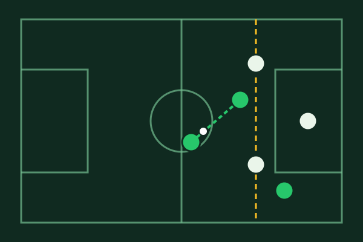
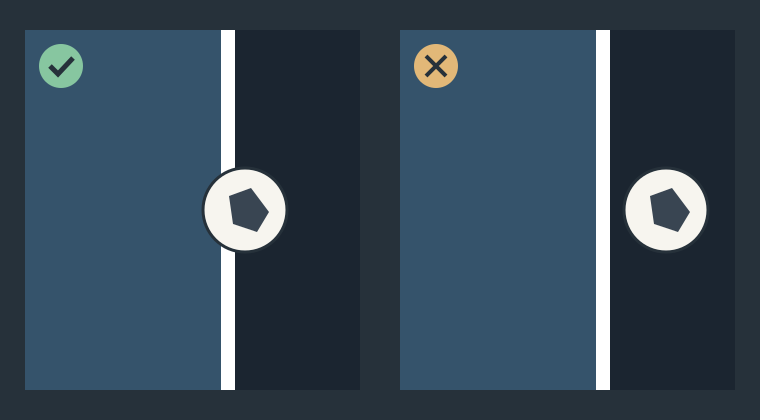
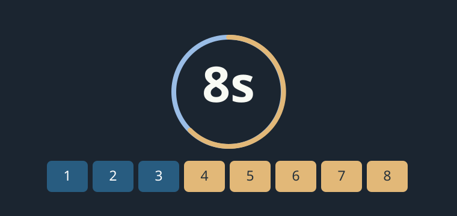
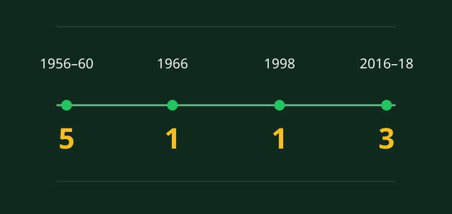
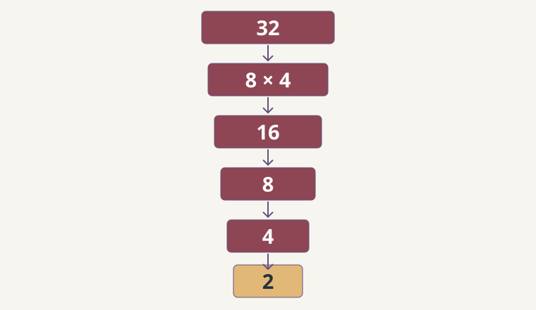
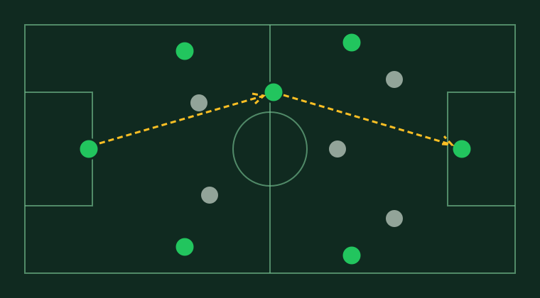
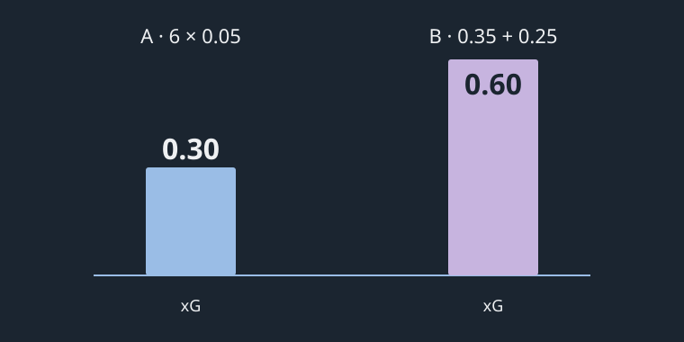

# Futebolando — caderno de revisão editorial

Versão de conteúdo: 9dbbe590b7ca38df9b5a23dec343ddbb6df99c3d. Blob: 8f77552f0075cad6e8d9f8daa4e28c9d44d17832. Oito artigos e 16 edições; conferência assistida realizada, aprovação humana pendente. Este arquivo é uma apresentação de leitura do catálogo, não fonte editorial editável. Não é uma autorização de publicação. As alterações devem ser feitas em Futebolando/editorial/articles.json e novamente sincronizadas.

## Como revisar

Leia os textos, confirme precisão, clareza, referências e ilustrações, e indique o ID da matéria e os pontos a corrigir. Aprovar texto não significa autorizar indexação ou monetização. A versão inglesa exige revisão linguística independente; a Libertadores ainda requer conferência visual do PDF e circulares aplicáveis. As ilustrações originais esquemáticas devem ser avaliadas com o texto.

## Índice

1. [Impedimento: como interpretar a posição e a participação no lance](#offside-guide)
2. [Em quais reinícios não há infração de impedimento?](#offside-restarts)
3. [Quando a bola realmente sai de jogo?](#ball-in-play)
4. [Os oito segundos do goleiro: por que a punição virou escanteio?](#goalkeeper-eight-seconds)
5. [Real Madrid: como uma história de conquistas europeias se construiu](#real-madrid-history)
6. [Como funciona a Libertadores? O formato e os critérios de 2026](#libertadores-format)
7. [Barcelona: de Cruyff a Guardiola, o que é o jogo posicional?](#barcelona-positional-play)
8. [O que é xG? Entenda por que nem toda finalização vale a mesma coisa](#expected-goals)

---

## 1. Impedimento: como interpretar a posição e a participação no lance

**ID:** `offside-guide` · **Status:** rascunho, revisão humana pendente.

O atacante recebe a bola, faz o gol e só então percebe a bandeira levantada. Para entender a decisão, vale separar duas coisas: a posição do jogador e sua participação no lance.

**Ilustração:** Diagrama esquemático de um campo com linha defensiva e posições de jogadores, sem representar uma partida real.

### Entenda em 30 segundos

Estar adiantado não é, por si só, uma infração. O árbitro precisa observar onde o atacante estava quando um companheiro jogou a bola e o que ele fez em seguida. Só há impedimento quando a posição irregular se combina com uma participação prevista na regra.

*Referências: 1.*

### Veja na prática

Imagine que um meia esteja prestes a lançar dois atacantes. Um deles já está à frente da defesa, enquanto o outro espera um pouco mais atrás. Se o primeiro estava em posição de impedimento no instante do passe e recebe a bola, pode ser punido. Se o segundo recebe o passe em situação regular e o primeiro não interfere, a jogada pode continuar.

Repare que os dois podem terminar a corrida no mesmo lugar. O que faz diferença é o ponto de partida no instante relevante e a participação de cada um. Por isso, olhar somente para o momento da recepção nem sempre explica a decisão.

*Referências: 1.*

### O que diz a Regra 11?

Para estar em posição de impedimento, uma parte válida do corpo precisa estar na metade adversária, sem contar a linha central, e mais próxima da linha de gol do que a bola e o penúltimo adversário. A comparação inclui cabeça, tronco e pés, mas exclui mãos e braços; o limite do braço fica na altura da parte inferior da axila. Se o atacante estiver nivelado com o penúltimo adversário ou com os dois últimos, não estará em posição de impedimento.

Depois de identificar a posição, o árbitro avalia a participação. Ela pode ocorrer quando o jogador toca na bola, interfere na ação de um adversário ou aproveita determinados rebotes, desvios e defesas. Confirmada a infração, a equipe adversária recebe um tiro livre indireto no local em que ela ocorreu.

*Referências: 1.*

### Quando a posição não conta toda a história

Um atacante que não toca na bola ainda pode interferir claramente na visão do goleiro. Em contrapartida, outro jogador pode permanecer adiantado sem participar da jogada. Há também situações em que a própria origem da bola muda a análise, como o recebimento direto de um lateral, tema do próximo episódio.

Outra distinção importante aparece quando a bola passa por um defensor. Um simples desvio não elimina necessariamente o impedimento, enquanto uma ação deliberada de jogar a bola pode permitir que o atacante a receba legalmente. A exceção a essa última situação é uma defesa deliberada para evitar um gol. Por isso, não basta observar se houve contato com o adversário: é preciso interpretar a natureza da ação.

*Referências: 1.*

### O instante do passe também mudou

A edição 2025/26 passou a indicar uma referência específica para lançamentos com as mãos do goleiro: o fim do contato com a bola. Nos demais toques e passes de companheiros, considera-se o início do contato. Essa diferença ajuda a entender por que o quadro usado para avaliar a posição depende da forma como a bola foi jogada.

*Referências: 2, 1.*

### Fontes

1. [IFAB — Law 11: Offside (2026/27 edition consulted)](https://www.theifab.com/laws/latest/offside/) — consulta registrada: 2026-11-26.
2. [IFAB — Law changes 2025/26](https://www.theifab.com/law-changes/2025-26/) — consulta registrada: 2026-11-26.

---

## 2. Em quais reinícios não há infração de impedimento?

**ID:** `offside-restarts` · **Status:** rascunho, revisão humana pendente.

Um atacante pode receber a bola atrás da defesa sem que a bandeira seja levantada. Em algumas reposições, essa decisão está expressamente prevista na regra.

### Entenda em 30 segundos

Não se marca impedimento quando um jogador recebe a bola diretamente de um arremesso lateral, tiro de meta ou escanteio. A exceção vale para esse recebimento, não para todos os passes que acontecem depois.

*Referências: 1.*

### Veja na prática

Imagine um lateral cobrado perto da área adversária. Um atacante se posiciona atrás dos defensores e recebe a bola diretamente do companheiro que fez a cobrança. Embora essa posição chamasse atenção em um passe comum, a origem da bola torna a situação diferente.

É justamente essa diferença que costuma passar despercebida: o jogador não ganha uma licença permanente para ficar adiantado. A regra apenas trata aquele recebimento de outra maneira.

*Referências: 1.*

### O que diz a Regra 11.3?

As três situações têm algo em comum: o jogador recebe a bola diretamente de um dos reinícios mencionados. A palavra diretamente é importante, porque delimita o alcance da exceção. Uma cobrança de falta, por exemplo, não está entre esses três reinícios.

Assim, duas jogadas visualmente parecidas podem exigir decisões distintas. Para entender qual delas está sujeita à análise de impedimento, é necessário saber de onde veio a bola.

O tiro de meta também não deve ser confundido com um lançamento comum do goleiro durante o jogo. O primeiro está entre as reposições expressamente isentas; o segundo exige a análise habitual de impedimento.

*Referências: 1.*

### O passe seguinte pode mudar tudo

Volte ao exemplo do lateral. Se o atacante recebe a bola e passa para outro companheiro, esse novo toque pode exigir uma avaliação normal de impedimento. A origem do primeiro recebimento já não resolve a situação seguinte.

*Referências: 1.*

### O detalhe que explica decisões diferentes

Na próxima partida, experimente observar o tipo de reposição antes de reparar na posição dos atacantes. Esse pequeno hábito ajuda a distinguir as três exceções de um passe comum, evitando confundir uma decisão correta com um erro da arbitragem.

*Referências: 1.*

### Fontes

1. [IFAB — Law 11: Offside (2026/27 edition consulted)](https://www.theifab.com/laws/latest/offside/) — consulta registrada: 2026-11-26.

---

## 3. Quando a bola realmente sai de jogo?

**ID:** `ball-in-play` · **Status:** rascunho, revisão humana pendente.

A bola parece ter saído, mas o árbitro deixa a partida seguir. Entender o que realmente precisa cruzar a linha ajuda a explicar esse tipo de lance.

**Ilustração:** Dois exemplos vistos de cima: uma bola ainda sobre a linha e outra inteiramente fora do campo.

### Entenda em 30 segundos

A bola só sai por uma linha lateral ou de gol depois que a ultrapassa completamente. Se uma parte dela ainda estiver sobre a linha, não saiu por completo. Isso vale tanto pelo chão quanto pelo ar.

*Referências: 1.*

### Veja na prática

Observe os dois exemplos da ilustração. No primeiro, a bola já avançou bastante para fora, mas ainda ocupa parte do espaço acima da linha branca. No segundo, não há mais sobreposição: a bola inteira está além da borda externa.

A comparação é útil porque, em uma transmissão, é fácil olhar para a parte da bola que toca a grama e esquecer que ela tem volume. A decisão depende do conjunto, e não apenas de sua base.

*Referências: 1.*

### O que diz a Regra 9?

A saída pelas linhas não é a única maneira de interromper a partida, pois o árbitro também pode parar o jogo. Se não houver outra interrupção, uma bola que bate na trave, no travessão ou na bandeira de escanteio e permanece dentro do campo pode continuar em jogo.

A partir daí, surge uma dúvida interessante: o que acontece quando a bola bate em alguém que não está disputando a partida? O contato com a arbitragem tem condições específicas.

*Referências: 1.*

### E se a bola tocar no árbitro?

O simples contato com um integrante da equipe de arbitragem, inclusive um assistente, não basta para interromper o lance. Se a bola permanece no campo, mas o toque muda a equipe que tem a posse, origina um ataque promissor ou manda a bola diretamente para o gol, o reinício é uma bola ao chão. Fora dessas situações, o toque por si só não determina a interrupção.

A edição 2026/27 também prevê um caso específico: se um membro da comissão técnica, suplente, jogador substituído ou expulso, ou atleta temporariamente fora do campo, toca na bola que está claramente saindo, ainda em jogo, sem intenção de interferir de maneira injusta, o reinício é um tiro livre indireto para a outra equipe. A regra não prevê cartão apenas por esse contato. É uma situação diferente de esperar a bola ultrapassar totalmente a linha.

*Referências: 1.*

### Por que a câmera pode enganar

Um ângulo inclinado pode esconder a parte da bola que ainda se projeta sobre a linha. Ao acompanhar uma repetição, procure uma perspectiva que permita observar a borda externa. Uma imagem isolada pode parecer convincente sem mostrar tudo que a decisão exige.

*Referências: 1.*

### Fontes

1. [IFAB — Law 9: The Ball in and out of Play (2026/27 edition consulted)](https://www.theifab.com/laws/latest/the-ball-in-and-out-of-play/) — consulta registrada: 2026-11-26.

---

## 4. Os oito segundos do goleiro: por que a punição virou escanteio?

**ID:** `goalkeeper-eight-seconds` · **Status:** rascunho, revisão humana pendente.

Demorar com a bola nas mãos deixou de provocar a antiga punição de tiro livre indireto. O novo limite e a cobrança de escanteio mudaram a forma de acompanhar essa situação.

**Ilustração:** Esquema temporal de oito segundos, com destaque para os cinco últimos segundos da contagem visual.

### Entenda em 30 segundos

Quando o goleiro controla a bola com as mãos ou os braços dentro da própria área por mais de oito segundos, a equipe adversária recebe um escanteio. O árbitro determina o início do controle e sinaliza visualmente os cinco segundos finais.

*Referências: 1.*

### Veja na prática

Imagine que o goleiro faça uma defesa e mantenha a bola junto ao peito. Depois de esperar alguns segundos, ele a quica no gramado, segura novamente e procura um companheiro livre para receber a reposição.

A contagem não começa de novo a cada quique, porque o goleiro ainda controla a bola. Portanto, para entender a decisão, é mais útil observar quando ele conquistou o controle do que contar apenas o tempo em que ficou parado.

*Referências: 1.*

### O que diz a Regra 12.3?

Cabe ao árbitro determinar quando a bola passou ao controle do goleiro. Nos cinco segundos finais, ele utiliza a mão levantada para tornar a contagem visível. Se o limite for ultrapassado, o escanteio será cobrado do lado mais próximo da posição do goleiro no momento da punição.

O cartão amarelo não acompanha necessariamente a primeira infração. A repetição da conduta, entretanto, pode levar à advertência. A cobrança e a sanção disciplinar são decisões distintas.

*Referências: 1.*

### E se um atacante impedir a reposição?

O goleiro não pode ser desafiado enquanto controla a bola com as mãos ou os braços. Se um adversário o impede de repor a bola, o árbitro precisa avaliar essa interferência. Não seria correto simplesmente ignorar a ação do atacante e aplicar o limite de tempo como se o goleiro estivesse livre para repor.

Se o atacante impedir a reposição e não houver vantagem a aplicar, o árbitro deve punir a infração em favor da equipe do goleiro: com tiro livre direto quando houver contato físico com o goleiro, ou indireto quando não houver contato. A eventual advertência depende das circunstâncias, como uma ação temerária ou a interrupção de um ataque promissor.

*Referências: 1.*

### De seis segundos para oito

A mudança de 2025/26 substituiu o limite anterior, de seis segundos, e a punição de tiro livre indireto por uma contagem de oito segundos com escanteio em caso de excesso. É um bom exemplo de como a regra pode evoluir mesmo quando a situação em campo parece familiar. Ao analisar uma partida antiga, lembre-se de verificar o regulamento daquela temporada.

*Referências: 2, 1.*

### Fontes

1. [IFAB — Law 12: Fouls and Misconduct (2026/27 edition consulted)](https://www.theifab.com/laws/latest/fouls-and-misconduct/) — consulta registrada: 2026-11-26.
2. [IFAB — Law changes 2025/26](https://www.theifab.com/law-changes/2025-26/) — consulta registrada: 2026-11-26.

---

## 5. Real Madrid: como uma história de conquistas europeias se construiu

**ID:** `real-madrid-history` · **Status:** rascunho, revisão humana pendente.

O clube espanhol tem uma relação especial com o principal torneio de clubes da Europa. Para entendê-la, vale olhar para diferentes gerações, não apenas para os troféus.

**Ilustração:** Linha do tempo dos títulos europeus do Real Madrid: cinco de 1956 a 1960, títulos em 1966 e 1998 e três entre 2016 e 2018; seleção de marcos, não lista completa.

### O começo de uma identidade

Quando o Madrid Foot Ball Club organizou sua primeira diretoria, em 6 de março de 1902, a competição continental que hoje conhecemos como Champions League ainda não existia. Mais de meio século depois, o clube encontraria nela uma parte decisiva de sua identidade esportiva.

A chegada da Copa dos Campeões Europeus na década de 1950 coincidiu com uma geração de jogadores liderada em campo por Alfredo Di Stéfano. O Real venceu as cinco primeiras edições, entre 1956 e 1960. A sequência ajuda a explicar por que seu nome se tornou tão associado ao torneio.

*Referências: 1, 2.*

### O que os diferentes ciclos revelam

O sexto título veio em 1966. Depois, foram 32 anos sem levantar a taça europeia: em maio de 1998, o Real derrotou a Juventus por 1 a 0, com gol de Mijatovic. Essa distância entre conquistas ajuda a enxergar uma história menos linear do que sugere a lista de troféus.

A competição recebeu o nome Champions League na temporada 1992/93. Entre 2016 e 2018, o Madrid venceu três edições consecutivas. No levantamento da UEFA de 30 de maio de 2026, somava 15 títulos da competição desde 1955/56, dos quais nove na era Champions League. O desenho reúne alguns marcos dessa trajetória, não todos os títulos.

*Referências: 2, 3.*

### Títulos explicam tudo?

A trajetória permite discutir como clubes atravessam mudanças de elenco, treinador e contexto competitivo. No entanto, uma lista de troféus mostra resultados, não demonstra sozinha as causas de cada vitória. Para avaliar gestão esportiva, formação ou investimento, precisaríamos de documentos financeiros e dados de diferentes temporadas.

A mesma cautela serve para analisar o Real em uma edição futura. Uma tradição de conquistas torna o clube uma referência histórica, mas não substitui a avaliação do elenco disponível, dos adversários e do desempenho recente.

*Referências: 1, 2.*

### O que acompanhar daqui em diante

Na próxima vez que comparar grandes equipes europeias, separe o histórico da forma atual. Os títulos ajudam a entender o passado de um clube; já os dados de criação e concessão de chances ajudam a interpretar o futebol que ele apresenta em campo. Essa distinção será útil também nas nossas análises sobre o Barcelona e os gols esperados.

*Referências: 2.*

### Fontes

1. [Real Madrid — 124 years of club history (6 March 2026)](https://www.realmadrid.com/en-US/news/club/latest-news/124-anos-de-leyenda-06-03-2026) — consulta registrada: 2026-11-26.
2. [UEFA — European Cup / Champions League honours, 30 May 2026](https://www.uefa.com/uefachampionsleague/news/0275-1541637ad1db-88aeeefefefd-1000--all-time-european-cup-honours-board/) — consulta registrada: 2026-11-26.
3. [Real Madrid — 28 years since winning the seventh European Cup (20 May 2026)](https://www.realmadrid.com/en-US/news/club/latest-news/hace-28-anos-se-gano-la-septima-copa-de-europa-20-05-2026) — consulta registrada: 2026-11-26.

---

## 6. Como funciona a Libertadores? O formato e os critérios de 2026

**ID:** `libertadores-format` · **Status:** rascunho, revisão humana pendente.

Da fase preliminar à decisão em jogo único, entenda o caminho até o título e a mudança no desempate dos grupos.

**Ilustração:** Fluxo da Libertadores 2026: 32 equipes, oito grupos de quatro, 16 classificadas às oitavas, oito às quartas, quatro às semifinais, duas à final.

### O caminho começa antes dos grupos

Para algumas equipes, a Libertadores começa com confrontos eliminatórios preliminares. Superada essa etapa, forma-se a fase de grupos com 32 clubes. A edição de 2026 distribuiu essas equipes em oito chaves de quatro, nas quais cada participante enfrenta os três adversários em casa e fora.

Ao fim das seis rodadas, os dois primeiros de cada grupo avançam às oitavas de final. O terceiro colocado ainda tem uma oportunidade continental, mas em outra competição: os playoffs das oitavas da Sul-Americana.

*Referências: 2.*

### O desempate mudou em 2026

Na fase de grupos, uma vitória vale três pontos, um empate vale um e uma derrota não acrescenta pontos. Quando há igualdade na tabela, porém, é preciso recorrer ao regulamento da edição.

Na versão de fevereiro de 2026 do manual, a primeira comparação é restrita às partidas entre os clubes empatados: pontos conquistados, diferença de gols e gols marcados, nessa ordem. Se necessário, passam a valer o saldo e os gols de todos os jogos do grupo. Persistindo a igualdade, contam menos cartões vermelhos, depois menos amarelos e, por fim, o sorteio. O documento também determina que a aplicação não volta a um critério anterior caso surja outro empate.

Em 2025, o saldo geral era o primeiro critério. O manual daquela edição ainda considerava gols fora de casa na fase de grupos e a posição no ranking da CONMEBOL em etapas posteriores do desempate. Essas regras não devem ser transportadas automaticamente para 2026.

*Referências: 1, 3.*

### Por que a final funciona de outra maneira

Nas oitavas, quartas e semifinais, os clubes jogam em ida e volta. Em igualdade de pontos, o saldo do confronto decide; persistindo o empate, a vaga é resolvida por pênaltis, sem prorrogação. Não existe um critério adicional de gol fora de casa nesse desempate.

A final de 2026 é disputada em partida única. Se o placar terminar igual no tempo regulamentar, o manual prevê mais 30 minutos, divididos em dois períodos de 15. Se o empate persistir, o campeão será definido nos pênaltis.

*Referências: 1, 2.*

### Um exemplo para acompanhar a tabela

Imagine dois times com dez pontos no grupo. Um tem saldo geral superior, mas o outro conquistou mais pontos nos jogos entre eles. Pelo primeiro critério do regulamento de 2026, o segundo fica à frente. Esse caso fictício mostra por que é importante conferir os confrontos diretos, e não apenas a coluna de saldo.

Antes de comparar classificações de temporadas diferentes, lembre-se de consultar a versão aplicável do regulamento. O formato geral pode parecer familiar mesmo quando um detalhe importante mudou.

*Referências: 1.*

### Fontes

1. [CONMEBOL — Manual de Clubes Libertadores 2026, versão atualizada de fevereiro, §§2.2–2.4, pp. 54–55](https://cdn.conmebol.com/wp-content/uploads/2025/12/CL-2026-Manual-de-Clubes-POR-2.pdf) — consulta registrada: 2026-11-26.
2. [CONMEBOL — Grupos da Libertadores 2026, 19 de março](https://gol.conmebol.com/libertadores/pt-br/news/rumo-gloria-eterna-este-sao-os-grupos-da-conmebol-libertadores-2026) — consulta registrada: 2026-11-26.
3. [CONMEBOL — Manual de Clubes Libertadores 2025, §2.4](https://cdn.conmebol.com/wp-content/uploads/2025/01/Manual-de-Clubes-CL-2025-POR-Digital.pdf) — consulta registrada: 2026-11-26.

---

## 7. Barcelona: de Cruyff a Guardiola, o que é o jogo posicional?

**ID:** `barcelona-positional-play` · **Status:** rascunho, revisão humana pendente.

Mais do que ter a bola, o jogo posicional envolve ocupar espaços e criar caminhos para avançar. A história do Barcelona ajuda a entender essa ideia.

**Ilustração:** Campo esquemático com jogadores distribuídos em largura e profundidade e uma combinação de terceiro homem; exemplo hipotético, não reconstrução de uma partida.

### Uma ideia que atravessou gerações

Ao assumir o Barcelona em 1988, Johan Cruyff iniciou uma fase marcada pelo jogo ofensivo e pela circulação de bola. O chamado Dream Team venceu quatro campeonatos espanhóis consecutivos, de 1991 a 1994, e conquistou a primeira Copa dos Campeões Europeus do clube, em 1992.

Guardiola, que havia sido jogador daquele time, voltou como treinador em 2008. Em sua primeira temporada, venceu a liga espanhola, a Copa do Rei e a Champions League. Ao fim de quatro temporadas, em 2012, somava 14 troféus, entre eles duas Champions. Os resultados dimensionam o ciclo; para entender a proposta tática, vale observar também como os jogadores se distribuíam no campo.

*Referências: 1, 2.*

### O espaço antes da bola

Uma forma de compreender o jogo posicional é observar a distribuição dos jogadores quando a equipe tem a posse. Alguns oferecem largura, aproximando-se das laterais; outros dão profundidade, ocupando espaços mais avançados. As posições podem mudar, mas os apoios precisam continuar disponíveis.

Essa organização procura criar alternativas para o jogador com a bola. Se os defensores se concentram de um lado, por exemplo, a circulação pode abrir uma opção no lado oposto. Nesse contexto, o passe deixa de ser apenas uma troca de posse entre companheiros: ele pode deslocar a defesa e preparar a progressão.

O material de treinamento da FIFA ajuda a explicar largura, profundidade, rotações e combinações por um terceiro jogador como princípios gerais. Ele não é uma análise das partidas históricas do Barcelona. A comparação aqui serve para apresentar o conceito, sem atribuir uma formação fixa ou uma causa única às conquistas.

*Referências: 3.*

### O terceiro homem na prática

Imagine três jogadores: um zagueiro, um meia e um atacante. A linha de passe direta entre zagueiro e atacante está fechada. O zagueiro toca no meia, que encontra o atacante em uma posição melhor para receber. O terceiro jogador é alcançado por uma combinação que contorna a pressão.

O desenho que acompanha o artigo é um exemplo criado para explicar esse princípio, e não uma reconstrução de uma partida do Barcelona. A ideia também não exige que os atletas sigam posições fixas o tempo inteiro; o que importa é como as opções se relacionam.

*Referências: 3.*

### Posse de bola não é o objetivo final

Ter a bola por mais tempo pode facilitar certas estratégias, mas a posse sozinha não mede a qualidade de um ataque. Uma equipe pode circular a bola sem criar perigo, enquanto outra progride rapidamente após recuperá-la. É por isso que a leitura tática ganha quando observa onde as ações acontecem, contra que adversário e que oportunidades elas produzem.

A série Futebol em números dará continuidade a essa questão ao explicar o xG, uma métrica que permite discutir a qualidade das finalizações sem confundir o número de chutes com o número de gols.

*Referências: 3.*

### Fontes

1. [FC Barcelona — 1988–1996: the Dream Team](https://www.fcbarcelona.com/en/card/643913/1988-1996-the-era-of-the-dream-team) — consulta registrada: 2026-11-26.
2. [FC Barcelona — Pep Guardiola's Barça, 2008–2012](https://www.fcbarcelona.com/en/guardiolas-barcelona) — consulta registrada: 2026-11-26.
3. [FIFA Training Centre — width, depth and third-player movement in practice](https://www.fifatrainingcentre.com/en/practice/training-perspectives/on-the-training-ground-with/gilberto-silva/on-the-training-ground-with-gilberto-silva-part-2.php) — consulta registrada: 2026-11-26.

---

## 8. O que é xG? Entenda por que nem toda finalização vale a mesma coisa

**ID:** `expected-goals` · **Status:** rascunho, revisão humana pendente.

Um time pode finalizar muito e criar pouco perigo. Os gols esperados ajudam a distinguir a quantidade de chutes da qualidade das oportunidades.

**Ilustração:** Exemplo fictício: equipe A, seis finalizações de 0,05 xG, total 0,30; equipe B, duas finalizações de 0,35 e 0,25 xG, total 0,60.

### O que o xG realmente mede?

O xG, abreviação de expected goals ou gols esperados, estima a chance de uma finalização resultar em gol. Para produzir essa estimativa, modelos analisam características de chutes anteriores, como distância, ângulo, parte do corpo usada e tipo de passe que antecedeu a tentativa. Alguns fornecedores incluem outras informações.

Um chute avaliado em 0,20 xG tem probabilidade estimada de gol de 20% segundo aquele modelo. Em muitas tentativas comparáveis, um modelo bem calibrado deve aproximar a frequência observada dessa estimativa. Isso não promete dois gols a cada dez chutes, nem transforma a qualidade de uma oportunidade em garantia de resultado.

*Referências: 1.*

### Mais chutes ou melhores chances?

Imagine duas equipes em uma partida fictícia. A equipe A finaliza seis vezes, e cada chute recebe um valor de 0,05 xG. A equipe B chuta apenas duas vezes, com valores de 0,35 e 0,25. Somados, os valores são 0,30 para A e 0,60 para B, como mostra o gráfico.

Embora A tenha produzido três vezes mais finalizações, B teve o maior total de gols esperados nesse exemplo. O xG permite enxergar uma diferença que a simples contagem de chutes esconde. Os números são inventados exclusivamente para ensinar o cálculo; não pertencem a um jogo ou clube real.

*Referências: 1.*

### Como ler o indicador ao longo de uma temporada

Para analisar um time, podemos somar o xG de seus chutes e o dos chutes que permitiu aos adversários, chamado de xGA (gols esperados contra). Quando a duração das amostras é diferente, dividir o total pelos minutos jogados e multiplicar por 90 ajuda a colocar os números na mesma escala. A normalização não corrige, por si só, diferenças na qualidade dos adversários.

Ainda assim, devemos considerar o nível dos adversários, os pênaltis, o estado do placar, a competição, a amostra e o fornecedor dos dados. Modelos de xG distintos podem atribuir valores diferentes a um mesmo chute. Uma comparação coerente começa por manter esses critérios explícitos.

*Referências: 1, 2.*

### O que os números não conseguem responder sozinhos

O maior xG de uma partida não garante a vitória e a soma dos xG não é a probabilidade de um time ganhar. Gols dependem do que efetivamente acontece, e uma avaliação de resultado futuro exigiria um modelo próprio, com hipóteses, dados e validação.

Por isso, nesta série vamos usar estatísticas para formular perguntas e interpretar o futebol, não para transformar uma métrica em certeza. O próximo passo será observar o que uma equipe produz e concede ao longo de uma amostra comparável de partidas.

*Referências: 1, 2.*

### Fontes

1. [StatsBomb — Understanding StatsBomb Radars (xG model and per-90 metrics)](https://blogarchive.statsbomb.com/articles/soccer/understanding-statsbomb-radars/) — consulta registrada: 2026-11-26.
2. [StatsBomb — The beginner's guide to football analytics](https://blogarchive.statsbomb.com/articles/soccer/the-beginners-guide-to-reading-writing-and-pitching-about-football-analytics/) — consulta registrada: 2026-11-26.

